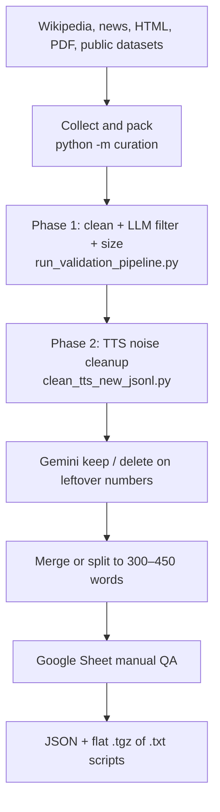
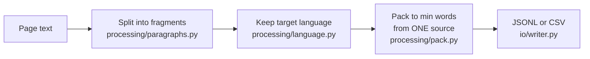
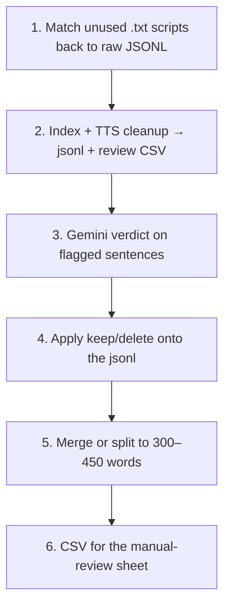

# Data curation — handoff for a new owner

This repo builds **reading scripts for Indic text-to-speech (TTS)**. It collects prose in the 22 scheduled languages of India, cleans it so a speaker can read it aloud, checks quality, and exports accepted scripts as text files plus an ingest JSON.

A script here means one paragraph of about **300–450 words** from a single source, in one language, with junk (URLs, IDs, citations, bare statistics) removed. The delivered unit is a `.txt` file such as `batch3_maithili_script_0001.txt`, listed in a JSON manifest.

Two names you will see outside this git tree:

| Name | What it is |
|---|---|
| **Apollo TTS dataset** | The full script set for a language (every exported `.txt`). |
| **Apollo dataset** | The subset that has already been completed / reviewed. |

Working copies of language data live in `raw_data/`, `new_data_batch3/`, `new_data_collection/`, `final/`, and `completed_scripts/`. Those folders are data, not library code.

---

## 1. What this project is for

The client needs spoken-style text, not a raw web dump. The project does four jobs:

1. **Collect** body text from Wikipedia, news and story sites, HTML books (for example Project Madurai), and PDFs.
2. **Keep only the target language** and pack it into long paragraphs from one source.
3. **Clean and validate** so the text is safe to read: no PII, no links, coherent prose, no sensitive content, and a stable word-count band.
4. **Hand the result to people**, then export the rows they accept into Drive as `.txt` files, a JSON manifest, and a flat `.tgz`.



The day-to-day sequence you will actually run is in [action_items.md](../action_items.md). It starts **after** Phase 1, from a `*_validated_cleaned.jsonl` file. Section 4 below walks that sequence in order. Section 3 explains the cleanup each step performs.

---

## 2. Languages and the JSONL row

Language codes (`--target-lang` and the JSON `language` field):

`as` Assamese, `bn` Bengali, `brx` Bodo, `doi` Dogri, `gu` Gujarati, `hi` Hindi, `kn` Kannada, `ks` Kashmiri, `kok` Konkani, `mai` Maithili, `ml` Malayalam, `mni` Manipuri, `mr` Marathi, `ne` Nepali, `or` Odia, `pa` Punjabi, `sa` Sanskrit, `sat` Santali, `sd` Sindhi, `ta` Tamil, `te` Telugu, `ur` Urdu.

`brx`, `doi`, `kok`, `mai`, `mni`, and `sat` are not in the fastText language-ID model. Those languages are kept by **Unicode script** (Manipuri = Meetei Mayek, Santali = Ol Chiki), not by fastText. See `curation/config.py`.

A curated row looks like this:

```json
{
  "source": "https://ta.wikipedia.org/wiki/இந்தியா",
  "paragraph": "… one block of text from that URL …",
  "language_code": "ta",
  "confidence": 0.98,
  "detection_method": "fasttext"
}
```

Later steps add `id` (1, 2, 3, …) and `domain` (education, news, stories, and so on). The ingest JSON that goes to Drive does **not** contain the paragraph. The paragraph is the `.txt` file. The JSON only names the file:

```json
{
  "data": {
    "file_name": "batch3_maithili_script_0001.txt",
    "language": "mai",
    "process_batch": "NRB0001"
  },
  "files": {
    "script_file": "batch3_maithili_script_0001.txt"
  }
}
```

`process_batch` is `NRB0001` for every language (`PROCESS_BATCH` in the Apps Script files).

---

## 3. What we fetch, and what we do to it

### 3.1 Collection — what text we take

Entry point: `python -m curation` (`curation/pipeline.py`). Full flag list: [README.md](../README.md).

| Source | How it is read | Code |
|---|---|---|
| Wikipedia article or main page | MediaWiki API, article body only | `curation/extractors/wikipedia.py` |
| Other websites | Same-host crawl from the article/main content. Nav and footer are dropped | `curation/extractors/web.py`, `crawl.py` |
| Local or remote `.html` | Trafilatura main-text extract | `curation/extractors/html.py` |
| PDF with a real text layer | PyMuPDF text blocks. Images are skipped | `curation/extractors/pdf.py` |
| Scanned PDF | Optional OCR (`--pdf-ocr` or `--auto-ocr`), Tesseract or EasyOCR | `curation/extractors/pdf_ocr.py` |
| A few publisher sites | Site-specific crawlers (Punjabi Kavita, Punjabi Library, Saral Gujarati, Bhashan Marathi, Hindi Vyakran, Ninemood, Prosestaa, Town Parle) | `curation/extractors/*.py` |

Many URLs in one file: `scripts/batch_curate_urls.py` (one URL at a time, append to one JSONL, continue after a failure).

After extraction, every page goes through the same three steps:



Rules that surprise people:

- Fragments from **different URLs or PDF pages are never merged**.
- Default `--min-words` is **500**. Text left under that limit at the end of a page is **dropped**.
- News articles are often 200–400 words, so `--min-words 500` can write **zero rows**. Use something like `--min-words 200` for short news.
- Language filter default confidence is **0.85**, and the text must mostly be in the expected script.

Public datasets (Kaggle, Hugging Face, Mendeley, AIKosh) were also loaded as JSONL with the dataset URL stored in `source`. Those files already sit under `final/<language>/` and `raw_data/`. You do not re-crawl them unless a language is short.

### 3.2 Phase 1 — make the paragraph safe and long enough

This is what produces `*_validated_cleaned.jsonl`, the file Phase 2 starts from.

Run it as one command:

```bash
python3 scripts/run_validation_pipeline.py --input final/gujarati/gujarati.jsonl --workers 10
```

That command runs two scripts.

#### Step A — `scripts/process_validated_jsonl.py`

Deterministic cleaning on `paragraph`, then **one Gemini (or OpenAI) call** per row for sensitivity, coherence, and domain.

| Check | What happens | Typical result |
|---|---|---|
| Unicode / mojibake | `ftfy` NFC normalize | Text rewritten |
| Control and private-use characters | Unicode categories Cf, Cc, Co stripped | Text rewritten |
| Email, Indian phone, Aadhaar, PAN | Regex redact to `[REDACTED]` | Row kept |
| `http(s)://` and `www.` links | Removed | Text rewritten |
| Emoji | Removed | Text rewritten |
| Decorative runs (`...`, `---`, `>>>`) | Stripped | Text rewritten |
| Words in the wrong script | Removed using `language_code` | Text rewritten |
| Pure Latin words | Removed by default | Text rewritten |
| Unbalanced `()` `[]` `{}` quotes | Closed or repaired | Text rewritten |
| Missing sentence end | `।` for most Indic, `۔` for Urdu/Sindhi/Kashmiri, `.` otherwise | Text rewritten |
| Empty after cleaning | Row dropped | Gone |
| Sensitivity score **above 0.30** | Hate, violence, sexual content | `{lang}_removed_sensitive.jsonl` |
| Coherence score **below 0.60** | Scraped junk, not readable prose | `{lang}_noncoherent.jsonl` |
| Gemini `PROHIBITED_CONTENT` block | Always dropped | Gone |
| LLM call fails | Row **kept**, `domain` set to `other` | Stays in cleaned file |
| Domain label | education, news, stories, biography, science_technology, legal_government, religion_culture, public_domain, information, other, or a new snake_case label | Stored on the row. Never drops a row |

Needs `GEMINI_API_KEY` in `.env` (or `OPENAI_API_KEY` if you pass `--llm-provider openai`).

#### Step B — `scripts/filter_min_words.py` (defaults when launched from the pipeline)

| Word count | Action |
|---|---|
| Under **300** | Dropped to `{stem}_removed_short.jsonl` |
| **300–450** | Kept |
| **451–1000** | Cut back to 450 words on a sentence boundary |
| Over **1000** | Split into chunks aimed at 300 words, each capped at 450 |

Rows from the same `source` are joined first. Counting is whitespace (`paragraph.split()`), unless you pass `--count-method tokenize`.

Output of the whole Phase 1 run: `{language}_validated_cleaned.jsonl`.

`python -m validation` is a **report-only** audit of the same ideas (words, links, NSW, PII, encoding, punctuation, and optional LLM domain/coherence/grammar/sensitivity). It writes `validation_reports/` and does not rewrite the dataset. Metric list: [validation/validation_readme.md](../validation/validation_readme.md).

### 3.3 Phase 2 — TTS cleanup (the path in `action_items.md`)

Readers cannot say raw citations, ISBNs, coordinates, or “see also” blocks. Phase 2 strips that, then asks Gemini about sentences that still contain numbers.

Patterns live in `validation/tts_cleanup.py` (catalogue: `validation_regex.txt`). `scripts/clean_tts_new_jsonl.py` splits them into two groups.

**Removed from the text** (junk, IDs, markup):

citation brackets, page/chapter/lesson IDs, figure and table refs, ISBN/ISSN/DOI, IP addresses, hex and color codes, math operators, chemical notation, hashtags and @mentions, copyright and trademark marks, author-year citations, “See also” / References blocks, list and table markup, bank and card numbers, PIN and postal codes, license plates, file paths, HTML entities, kaomoji.

**Left in the text, but the sentence is sent for review** (numbers a human or Gemini must judge):

latitude/longitude, temperature, units, time zones, clock times, durations, roman numerals, footnote markers, dates, percentages, currency, long statistics, decimals, ratios, version numbers, ordinals.

Outputs of `clean_tts_new_jsonl.py`:

| File | Contents |
|---|---|
| `{lang}_cleaned_tts_new.jsonl` | Kept scripts, each with an `id` |
| `{lang}_cleaned_tts_new_check.csv` | Only scripts that still have a CHECK pattern. Columns: `id`, `script`, then `sentence1`, `sentence2`, … for the flagged sentences |
| `{lang}_cleaned_tts_new_dropped.jsonl` | Empty after cleanup, or list-heavy if that flag is on |
| `{lang}_cleaned_tts_new_stats.json` | Counts |

`scripts/segment_cleanup_verdict.py` sends each flagged sentence to **Gemini Batch** (`gemini-2.5-flash`). Policy:

| Situation | Verdict |
|---|---|
| Cleanup does not change the meaning | **Keep**, junk tokens removed |
| Tokens are complex and they destroy the meaning | **Delete** the sentence |
| Tokens are complex but the sentence still makes sense | **Keep**, with those tokens removed |
| Model is unsure | **Review** (a person decides) |

Only ordinary conversational numbers (ordinals, “in the second year”) stay. Other numerics are treated as removable. The job id is saved beside the CSV so a re-run resumes polling instead of paying again.

`scripts/apply_gemini_review_jsonl.py` writes those verdicts back onto the JSONL:

- Match CSV `script number/ID` to JSONL `id`.
- Find `Segments/scripts` inside `paragraph`.
- `DELETE` or `Review` → delete that sentence.
- Otherwise → replace it with `cleaned segment (retain)`.

### 3.4 Sizing for recording — 300 to 450 words

`scripts/merge_short_tts_jsonl.py`:

| Words | Action |
|---|---|
| **300–450** | Kept as-is |
| **Under 300** | Merged with another short script of the **same `domain` and `source`**, aiming for 300–450. If the merge passes 450, it is cut at a sentence boundary |
| **451–599** | Cut down to at most 450 at a sentence boundary |
| **600 or more** | Split into `{id}.1`, `{id}.2`, … each 300–450 words |
| Still under 300 | `{lang}_short_script.jsonl` (not sent for recording) |

Kept rows go to `{lang}_tts_merged.jsonl`.

### 3.5 Manual QA and Drive export

`scripts/jsonl_paragraph_to_csv.py` writes `paragraph, word_count` for the sheet. Reviewers work in Google Sheets. Columns you will see on a finished sheet include Script, Edited Script, word count, Did you Edit?, Status, QA Status, QA comments, Injected?, and Unique script IDs (for example `batch3_maithili_script_0001`).

Export is **not** a Python script. Paste `scripts/apps_script_tts_export.gs` into the sheet (Extensions → Apps Script). Menu: **Export TTS → Export active tab**. It asks for a language code (`mai`), a locale for filenames (`maithili`), and a Drive folder.

A row is exported only when:

- QA Status is `1. accepted`
- Injected? is blank (already-exported rows are skipped)
- Edited Script is non-empty

The script writes the Edited Script into `batch3_{locale}_script_NNNN.txt`, fills Injected? = `yes` and the Unique script ID, then builds the JSON manifest and a **flat** `{locale}_files.tgz` (extracting it drops `.txt` files in the current directory, with no extra folder). Large sheets pause before Apps Script’s 6-minute limit and resume from a trigger.

Re-export of rows that were already injected, after a later edit: `scripts/apps_script_tts_reexport.gs` in a **separate** Apps Script project (the function names clash). It prefixes ids with `new_` (`new_batch3_maithili_script_0001`). If Did you Edit? is yes it uses Edited Script; if no or blank it uses Script.

Google Drive often labels a local `.tgz` upload as an unknown file type. The archive is still a normal gzip tar. Download it and run `tar -xzf <file>.tgz`.

---

## 4. Sequence of action items

Source of truth for the commands: [action_items.md](../action_items.md). The numbers in that file repeat (two step 2s and two step 3s). The order below is the order to run them. Swap the language and paths; the Santali / Maithili / Urdu examples are the templates.



### Current pipeline (new or unused data)

**1. Put unused scripts back on the raw paragraph**

Some `.txt` scripts were exported and then expired or unused. This finds the original raw paragraph so it can go through validation again. One raw paragraph is written once, even if several scripts matched it.

```bash
python3 scripts/match_unused_scripts_to_raw.py \
  --list unused_scripts/Urdu_expired_unused_scripts.txt \
  --scripts-dir "Apollo TTS dataset/urdu_phase_3/" \
  --raw new_data_batch3/urdu_validated_cleaned.jsonl
```

Writes `{stem}_matched_raw.jsonl`, `{stem}_unmatched.jsonl`, and `{stem}_match_report.json` next to the list file. Match order: exact normalized text, then a prefix-index substring, then a bounded fuzzy match.

**2. Clean and index; pull out sentences that still have numbers**

```bash
python3 scripts/clean_tts_new_jsonl.py \
  --input new_data_batch3/santali_validated_cleaned.jsonl \
  --output-dir new_data_batch3/santali/
```

**3. Ask Gemini keep / delete / review**

```bash
python scripts/segment_cleanup_verdict.py \
  cleaned_scripts/manipuri_cleaned_tts_new_check.csv
```

Input is the `*_cleaned_tts_new_check.csv` from step 2. Output is a verdict CSV beside it. Re-running the same command resumes the Gemini batch job.

**4. Apply the verdicts**

```bash
python3 scripts/apply_gemini_review_jsonl.py \
  --csv new_data_batch3/santali/santali_cleaned_tts_new_check_verdicts.csv \
  --jsonl new_data_batch3/santali/santali_cleaned_tts_new.jsonl \
  --output new_data_batch3/santali/final_santali_new.jsonl
```

**5. Force every paragraph into 300–450 words**

```bash
python3 scripts/merge_short_tts_jsonl.py \
  --input new_data_batch3/santali/final_santali_new.jsonl
```

**6. Sheet for manual review**

```bash
python3 scripts/jsonl_paragraph_to_csv.py \
  --input new_data_batch3/maithili/maithili_tts_merged.jsonl
```

After reviewers finish, export with `scripts/apps_script_tts_export.gs` (section 3.5).

### Already completed (do not re-run unless you are repairing a review)

These were used to score scripts that were **already finished**, not to build a new dataset.

```bash
# Whole-script Gemini review of a folder of .txt files
.venv/bin/python scripts/gemini_review_txt_folder.py \
  --folder Apollo_dataset/assamese/ \
  --output completed_scripts/assamese/assamese_script_analysis.csv \
  --workers 8

# Segment-level review, mapped back onto the raw paragraph
python3 scripts/gemini_review_json_segments.py \
  --folder Apollo_dataset/malayalam \
  --raw new_data_batch3/malayalam_validated_cleaned.jsonl \
  --output completed_scripts/malayalam/malayalam_segments_gemini_review.csv \
  --workers 8

# Retry rows whose verdict is an API or JSON parse error
.venv/bin/python scripts/retry_gemini_review_csv.py \
  --csv completed_scripts/assamese/assamese_script_analysis.csv \
  --batch-size 4 --workers 4
```

---

## 5. Every script — what it does and when to use it

Run Python from the repo root with the venv active (`source .venv/bin/activate`). Gemini steps read `GEMINI_API_KEY` from `.env`.

### Collecting text

| Script | Responsible for | Use it when |
|---|---|---|
| `python -m curation` | Extract, language-filter, and pack one or more PDFs, HTML files, or URLs into JSONL/CSV | You are adding new pages or books. Flags: [README.md](../README.md) |
| `scripts/batch_curate_urls.py` | Same pipeline, one URL per line from a text file, appended to one JSONL. `--start` / `--end` resume a slice. `--fresh` wipes the output first | A language has a long URL list (`tamil.txt`, `malayalam_links.txt`) |

### Phase 1 — validation (before `action_items.md`)

| Script | Responsible for | Use it when |
|---|---|---|
| `scripts/run_validation_pipeline.py` | Runs the next two scripts in order. `--all` walks `final/*/*.jsonl` | Normal way to produce `*_validated_cleaned.jsonl` |
| `scripts/process_validated_jsonl.py` | Deterministic cleanup plus LLM sensitivity, coherence, and domain | You need only step A, or different thresholds (`--coherence-threshold`, `--workers`) |
| `scripts/filter_min_words.py` | Drop short rows, trim 451–1000, split rows over 1000 | You need only the word-count pass (`--in-place` overwrites the input) |
| `scripts/clean_validated_jsonl.py` | Older cleaner: PII, links, emoji, encoding, punctuation. Optional LLM sensitivity only. No coherence or domain | A one-off clean when you do not want the full Phase 1 LLM pass |
| `scripts/filter_coherence.py` | LLM coherence only. Rewrites the input in place and writes `{language}_noncoherent.jsonl` | Coherence was skipped or the threshold changed after cleaning |
| `scripts/remove_latin_words_jsonl.py` | Strip pure Latin-script words. No LLM. `--all --in-place` or `--dry-run` | An older `*_validated_cleaned.jsonl` was built before Latin removal was the default |
| `scripts/tag_domains.py` | LLM domain label only. Does not clean or drop rows. `--retag-other` retries rows already marked `other` | Domain tagging failed or was skipped |
| `python -m validation` | Read-only metric report (does not edit text) | You need a quality summary, not a new dataset. See `validation/validation_readme.md` |

### Phase 2 — the current action-item path

| Script | Responsible for | Use it when |
|---|---|---|
| `scripts/match_unused_scripts_to_raw.py` | Map unused `.txt` names back to unique raw paragraphs | Action item 1. Expired or unused Apollo scripts must re-enter the pipeline |
| `scripts/clean_tts_new_jsonl.py` | Strip TTS junk, index ids, write the CHECK-sentence CSV | Action item 2. Input is `*_validated_cleaned.jsonl` |
| `scripts/segment_cleanup_verdict.py` | Gemini Batch keep / delete / review per flagged sentence | Action item 3 |
| `scripts/apply_gemini_review_jsonl.py` | Copy verdicts onto the cleaned JSONL | Action item 4 |
| `scripts/merge_short_tts_jsonl.py` | Merge, trim, and split into the 300–450 word band | Action item 5 |
| `scripts/jsonl_paragraph_to_csv.py` | `paragraph` + `word_count` CSV for the review sheet | Action item 6 |
| `scripts/clean_tts_nsw_jsonl.py` | Older TTS pass: same regex family, and it also resizes to 300–450 in one step (`*_tts_cleaned.jsonl`, plus short / overflow / dropped files) | A language that was finished on the old Phase 2 path. New work uses `clean_tts_new_jsonl.py` plus `merge_short_tts_jsonl.py` instead |

### Review of scripts that are already complete

| Script | Responsible for | Use it when |
|---|---|---|
| `scripts/gemini_review_txt_folder.py` | Gemini keep / delete / review on each `.txt` in a folder (whole script, not sentences) | Completed-script pass. Output CSV in `completed_scripts/` |
| `scripts/gemini_review_json_segments.py` | Same verdict, one row per JSON segment, with the matching span from raw JSONL | You have Apollo DS JSON (segments) and the raw JSONL |
| `scripts/retry_gemini_review_csv.py` | Re-call Gemini for rows whose `verdict_description` is an API or parse error. Skips `PROHIBITED_CONTENT` unless `--include-blocked` | A review CSV has timeout or invalid-JSON rows. Updates the CSV in place |

### Comparing cleaned text with raw text

| Script | Responsible for | Use it when |
|---|---|---|
| `scripts/find_tts_cleanup_removals.py` | Diff a cleaned script or segment file against raw JSONL and list tokens that cleanup removed, per segment | You need a removal audit (`Removal/<language>.jsonl`) |
| `scripts/split_removals_by_numbers.py` | Split that removal file into accepted (no edits), review (non-numeric removals), and rejected (removals that contain digits) | You want numeric deletions separated from harmless ones |

### Export and client reports

| Script | Responsible for | Use it when |
|---|---|---|
| `scripts/export_phase_one_dataset.py` | Write the first N paragraphs as `{language}_script_NNNN.txt` plus a dataset JSON. `--phase 2` takes the next slice and continues the numbers | An early phase dump from `*_validated_cleaned.jsonl` or `*_tts_cleaned.jsonl`, before the Google Sheet flow |
| `scripts/apps_script_tts_export.gs` | Sheet → Drive: accepted Edited Scripts, JSON manifest, flat `.tgz`, Unique script IDs | After manual QA. Paste into the spreadsheet. Not run with Python |
| `scripts/apps_script_tts_reexport.gs` | Second export of already-injected rows, filenames prefixed with `new_` | A reviewed sheet was edited again. Separate Apps Script project |
| `scripts/summarize_final_validation.py` | CSV rollup of JSONL files under `final/` | A counts snapshot across languages |
| `scripts/analyze_vocabulary_diversity.py` | Unique-word percentage per language. Writes `final/vocabulary_diversity_report.md` and `.json` | Diversity report. Paths are hardcoded to `final/<language>/` |
| `scripts/generate_language_dataset_report_docx.py` | DOCX from `final/language_dataset_reports.json` | Client Word report of sources and domains |
| `scripts/generate_validation_report_docx.py` | DOCX of the Phase 1 / Phase 2 validation write-up | Client Word copy of `final/validation_report.md` |
| `scripts/generate_vocabulary_diversity_report_docx.py` | DOCX from `final/vocabulary_diversity_reports.json` | Client Word copy of the diversity report |

---

## 6. Where the code lives

```text
data_curation/
├── action_items.md          # commands for the current language you are processing
├── docs/onboarding.md       # this document
├── README.md                # collection CLI (python -m curation)
├── validation_regex.txt     # human-readable list of TTS patterns
├── curation/                # fetch, language filter, pack
│   ├── pipeline.py
│   ├── config.py            # 22 language codes, script map
│   ├── extractors/          # wikipedia, web, html, pdf, site-specific
│   └── processing/          # paragraphs, language, pack
├── validation/              # metric library + tts_cleanup.py
│   └── validation_readme.md
├── scripts/                 # every command in sections 4 and 5
├── final/                   # phase-1 language JSONL and client reports
├── raw_data/                # *_validated_cleaned.jsonl and per-language folders
├── new_data_batch3/         # current per-language working folders
├── new_data_collection/
├── completed_scripts/       # Gemini review CSVs for finished languages
└── Removal/                 # token-diff audits
```

Setup:

```bash
cd /path/to/data_curation
python3 -m venv .venv
source .venv/bin/activate
pip install -r requirements.txt
pip install -r requirements-validation.txt
```

Put `GEMINI_API_KEY=...` in `.env` at the repo root. The fastText model (`lid.176.bin`) downloads itself to `~/.cache/data_curation/models/` on the first collect run. PDF OCR needs Tesseract language packs, or `easyocr`.

---

## 7. Practical notes

- Do not merge text across sources. Packing, short-script merge, and the sheet all assume one `source` (and, at merge time, one `domain`).
- Phase 1 drops low-coherence and high-sensitivity rows. Phase 2 Gemini `Review` and `Delete` drop **sentences**, not always the whole script.
- `clean_tts_new_jsonl.py` does not overwrite its input. `filter_coherence.py`, `tag_domains.py`, and `remove_latin_words_jsonl.py --in-place` do.
- Word targets are not the same at every stage. Collection default is 500 and drops the tail. Phase 1 via `run_validation_pipeline.py` keeps 300–450 and splits only above 1000. The recording step (`merge_short_tts_jsonl.py`) keeps 300–450 and splits above 600.
- Apps Script exports use **Edited Script** whenever it is non-empty. An accepted row with an empty Edited Script is skipped and not marked Injected.
- `final/validation_report.md` describes the older Phase 2 script (`clean_tts_nsw_jsonl.py`). The live path in `action_items.md` is `clean_tts_new_jsonl.py`.
