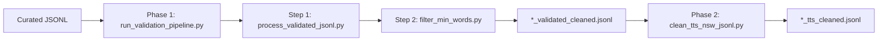

# Data Curation Validation Report

This document summarizes the validation parameters applied in **Phase 1** and **Phase 2** of the curated JSONL pipeline.

| Phase | Entry script | Input | Primary output |
|-------|--------------|-------|----------------|
| **Phase 1** | `scripts/run_validation_pipeline.py` | `final/<language>/<language>.jsonl` | `{language}_validated_cleaned.jsonl` |
| **Phase 2** | `scripts/clean_tts_nsw_jsonl.py` | `{language}_validated_cleaned.jsonl` | `{language}_tts_cleaned.jsonl` |

> **Note:** Phase 2 is implemented in `scripts/clean_tts_nsw_jsonl.py` (NSW = non-standard words). There is no `clean_tts_new_jsonl.py` in this repository.

---

## Pipeline overview



---

## Phase 1 — Validation pipeline

**Script:** `scripts/run_validation_pipeline.py`

Phase 1 runs two steps in sequence:

1. `scripts/process_validated_jsonl.py` — text cleaning + LLM quality filtering
2. `scripts/filter_min_words.py` — word-count filtering, pruning, and splitting (in-place on step 1 output)

### Default CLI parameters (Phase 1)

| Parameter | Default | Step | Description |
|-----------|---------|------|-------------|
| `--workers` | `8` | Step 1 | Parallel LLM requests |
| `--coherence-threshold` | `0.60` | Step 1 | Drop rows with LLM coherence **below** this score |
| `--sensitivity-threshold` | `0.30` | Step 1 | Drop rows with LLM sensitivity **above** this score |
| `--remove-latin-words` | enabled | Step 1 | Strip pure Latin-script words from paragraphs |
| `--skip-sensitivity` | off | Step 1 | When set, skip sensitivity filtering |
| `--llm-provider` | env / `gemini` | Step 1 | LLM backend: `gemini`, `openai`, or `gpt` |
| `--min-words` | `300` | Step 2 | Minimum words required to keep a row |
| `--max-words` | `450` | Step 2 | Hard maximum words per paragraph chunk |
| `--split-threshold` | `1000` | Step 2 | Paragraphs above this are split into multiple chunks |
| `--target-words` | same as `--min-words` (`300`) | Step 2 | Preferred chunk size when splitting long paragraphs |
| `--count-method` | `split` | Step 2 | Word counting: whitespace split (or `tokenize` for Indic-aware boundaries) |

---

### Step 1 — Text cleaning (`process_validated_jsonl.py`)

Deterministic cleaning is applied to every row **before** LLM evaluation. Rows that become empty after cleaning are dropped.

| # | Validation / cleaning parameter | Method | Action |
|---|--------------------------------|--------|--------|
| 1 | **Unicode normalization** | `ftfy` (NFC) or `unicodedata` fallback | Fix mojibake and normalize text |
| 2 | **Format / control characters** | Unicode category (`Cf`, `Cc`, `Co`) | Strip invisible / control / private-use characters |
| 3 | **PII redaction** | Regex | Redact email, Indian phone (+91), Aadhaar (12-digit), PAN → `[REDACTED]` (row kept) |
| 4 | **Links** | Regex | Remove `http(s)://` and `www.` URLs |
| 5 | **Emoji** | Unicode regex | Remove emoji characters |
| 6 | **Decorative runs** | Regex | Strip runs of 3+ dots, dashes, or angle brackets (`...`, `---`, `>>>`, `<<<`, `…`) |
| 7 | **Serial navigation boilerplate** | Regex | Remove Telugu serial-part navigation text (scraping artifacts) |
| 8 | **Leading parenthesis runs** | Regex | Strip long runs of `((((` at paragraph start |
| 9 | **Foreign script words** | Script-aware tokenization | Remove words not in the expected script for `language_code` |
| 10 | **Latin words** | Script-aware tokenization | Remove pure Latin-script words (default: **on**) |
| 11 | **Unbalanced brackets / quotes** | Bracket-pair check | Auto-close or prepend missing `()`, `[]`, `{}`, `«»`, smart quotes |
| 12 | **Terminal punctuation** | Sentence splitting + language rules | Add missing sentence terminators (`।` for Indic, `۔` for Urdu/Sindhi, `.` otherwise) |
| 13 | **Empty paragraph** | Length check | Drop row if paragraph is empty after cleaning |

**Step 1 outputs**

| File | Contents |
|------|----------|
| `{language}_validated_cleaned.jsonl` | Rows that pass all filters; includes LLM-assigned `domain` |
| `{language}_noncoherent.jsonl` | Rows dropped for low coherence (with `_coherence` metadata) |
| `{language}_removed_sensitive.jsonl` | Rows dropped for high sensitivity (with `_sensitivity` metadata) |
| `{language}_processing_stats.json` | Run summary (counts, thresholds, provider) |

---

### Step 1 — LLM quality filtering (`process_validated_jsonl.py`)

One combined LLM call per row evaluates sensitivity, coherence, and domain classification.

| # | Validation parameter | Threshold (default) | Drop condition | Notes |
|---|---------------------|---------------------|----------------|-------|
| 1 | **Sensitivity** | `≤ 0.30` | Drop if score **>** threshold | Hate speech, explicit violence, sexual content, etc. (0 = safe, 1 = highly sensitive) |
| 2 | **Coherence** | `≥ 0.60` | Drop if score **<** threshold | 1 = natural coherent prose; 0 = incoherent scraping garbage |
| 3 | **Domain classification** | — | Never drops | Assigns content domain to kept rows |
| 4 | **Prohibited content** | — | Always drop | Rows blocked by `prompt_feedback.block_reason: PROHIBITED_CONTENT` |
| 5 | **LLM failure** | — | Row **kept** | On API/parse failure, row is kept with `domain = "other"` |

**Domain taxonomy** (preferred labels; LLM may propose a new 1–3 word snake_case label):

`education`, `public_domain`, `news`, `stories`, `information`, `biography`, `science_technology`, `legal_government`, `religion_culture`, `other`

---

### Step 2 — Word-count filtering (`filter_min_words.py`)

Runs **in-place** on `{language}_validated_cleaned.jsonl` with the Phase 1 defaults above.

| # | Validation parameter | Default | Action |
|---|---------------------|---------|--------|
| 1 | **Source consolidation** | always | Merge consecutive rows from the same `source` into one paragraph (exact duplicate paragraphs within a source deduplicated) |
| 2 | **Decorative dot/dash stripping** | always | Strip 3+ dot/dash/gt/lt runs before word counting |
| 3 | **Minimum word count** | `300` | Drop rows below threshold → `{stem}_removed_short.jsonl` |
| 4 | **Maximum word count** | `450` | Hard cap per chunk |
| 5 | **Prune band** | `451–1000` words | Trim to `450` words at sentence boundaries |
| 6 | **Split band** | `> 1000` words | Split into multiple chunks targeting `300` words, capped at `450` |
| 7 | **Word counting** | `split` (whitespace) | Optional `tokenize` for Indic-aware token boundaries |
| 8 | **Sentence boundaries** | cross-script regex | Splits on `।`, `॥`, `۔`, `؟`, `!`, `?`, `…`, and `.` (when not a decimal) |

**Step 2 outputs**

| File | Contents |
|------|----------|
| `{language}_validated_cleaned.jsonl` | Overwritten in-place with kept/sized rows |
| `{language}_removed_short.jsonl` | Rows dropped for `< 300` words (includes `_word_count`) |
| `{language}_min_words_stats.json` | Aggregate counts (kept, pruned, split, dropped) |

---

## Phase 2 — TTS / NSW cleanup

**Script:** `scripts/clean_tts_nsw_jsonl.py`  
**Core logic:** `validation/tts_cleanup.py` (patterns defined in `validation_regex.txt`)

Phase 2 removes **TTS-hostile non-standard words (NSW)** and routes paragraphs into TTS-ready word-count buckets.

### Default CLI parameters (Phase 2)

| Parameter | Default | Description |
|-----------|---------|-------------|
| `--keep-list-heavy` | off (lists **are** dropped) | Keep list/table-heavy paragraphs instead of dropping |
| `--list-heavy-min-markers` | `5` | Drop when paragraph has ≥ this many list/table markers |
| `--no-split` | off (splitting **enabled**) | Only apply NSW cleanup; skip paragraph splitting |
| `--in-place` | off | Overwrite input instead of writing `*_tts_cleaned.jsonl` |

### Hard-coded word-count targets (Phase 2)

| Constant | Value | Use |
|----------|-------|-----|
| `TTS_MIN_WORDS` | `300` | Minimum words for main kept output |
| `TTS_MAX_WORDS` | `450` | Maximum words for a single kept chunk |
| `TTS_SPLIT_TARGET_LOW` | `300` | Lower bound when splitting 451–599 word paragraphs |
| `TTS_SPLIT_TARGET_HIGH` | `400` | Upper bound when splitting 451–599 word paragraphs |

---

### Pre-cleanup drop rules

| # | Validation parameter | Default | Drop condition |
|---|---------------------|---------|----------------|
| 1 | **List-heavy paragraphs** | on | ≥ `5` bullet/numbered/table markers, **or** ≥ `6` pipe (`\|`) characters, **or** ≥ `40%` of lines are numbered list items (with ≥ 4 non-empty lines) |
| 2 | **Empty after cleanup** | always | Paragraph is blank after all NSW stripping |

---

### Text preprocessing (before pattern removal)

| # | Step | Description |
|---|------|-------------|
| 1 | `ftfy` repair | Fix encoding issues when available |
| 2 | Whitespace normalization | Replace NBSP; strip zero-width characters |
| 3 | Box / checkbox placeholders | Remove `■`, `☐`, `☑`, etc. |
| 4 | NFC normalization | Unicode normalization |
| 5 | Wiki markup stripping | Remove `[[…]]`, `[…]`, `{{…}}` markup |
| 6 | Parenthetical stripping | Remove `(...)` blocks iteratively |
| 7 | Block-pattern removal | Drop reference/boilerplate lines (see below) |
| 8 | Cosmetic cleanup | Collapse whitespace, fix orphan punctuation, remove dangling connectors |
| 9 | Regex pattern removal | Remove all NSW patterns (see tiers below) |

**Block patterns removed (whole lines / blocks)**

- `See also`, `References`, `Further reading`, `External links`, `Notes`, `Bibliography`, `Sources`, `Footnotes`, `citation needed`
- Horizontal rule lines (`---`, `===`, `***`)
- Numbered / lettered list line prefixes (`1.`, `a)`, `iv.`)
- Wiki-style table rows (`| col | col |`)
- Leading decorative dot runs

---

### NSW regex patterns removed (by tier)

Patterns follow `validation_regex.txt`. Each match is replaced with whitespace (not a hard row drop unless the paragraph becomes empty).

#### Tier 1 — Compound / long patterns

| Label | Examples removed |
|-------|------------------|
| `isbn_issn_doi` | ISBN, ISSN, DOI strings |
| `ip_address` | `192.168.1.1` |
| `hex_color` | `#FF5733`, `RGB(255,0,0)` |
| `file_paths` | File paths, extensions (`.jsonl`, `.pdf`, …), `en.wikipedia.org/wiki/...` |
| `html_entities` | `&nbsp;`, `&amp;`, `&#123;`, etc. |
| `latlon_block` | Coordinate blocks (`Coordinates: 26°51′N …`) |
| `dms_notation` | Degree-minute-second (`32°05′14″N`) |
| `temperature` | `35°C`, `98.6°F` |
| `scientific_notation` | `1.5×10⁶`, `3.14e-8` |
| `chemical_formula` | `H2O`, `CO2`, `pH 7.4` |
| `subscript_superscript` | Unicode super/subscript digits |
| `bank_card_numbers` | 16-digit card patterns |
| `currency` | `₹500`, `Rs. 1,25,000`, `$10`, `50 rupees` |
| `numeric_commas` | `23,500`, `1,25,000` |

#### Tier 2 — Units, time, dates, references

| Label | Examples removed |
|-------|------------------|
| `measurement_units` | `35 km`, `500 kg`, `m/s`, `kPa`, `MHz`, etc. |
| `percentage` | `50%`, `12.5 %` |
| `timezone` | `IST`, `GMT+5:30`, `UTC+05:30` |
| `clock_time` | `14:30`, `9:00 AM` |
| `duration` | `2h 30m`, `45 min`, `30 seconds` |
| `dates` | `18-06-2024`, `2024-06-18`, year ranges |
| `ratio_scale` | `1:50000`, `2:1` |
| `version_model` | `v2.0`, `iPhone 14`, `Windows 11` |
| `page_chapter` | `page 12`, `Chapter 3`, `பாடம் 4.1`, `अध्याय 2` |
| `fig_table_ref` | `Fig. 4.1`, `Table 2`, `படம் 4.9`, `चित्र 3` |

#### Tier 3 — Citations, symbols, ordinals

| Label | Examples removed |
|-------|------------------|
| `roman_numerals` | `XII`, `Chapter IV` |
| `citation_brackets` | `[1]`, `[citation needed]`, `[edit]` |
| `footnote_markers` | `†`, `‡`, `§`, `¶`, `*` |
| `ordinals_english` | `15th`, `3rd` |
| `ordinals_indic` | Tamil/Telugu/Malayalam/Hindi ordinal forms with digits |
| `pin_postal` | 4–6 digit standalone numbers |
| `license_plate` | Indian vehicle registration patterns |
| `author_year_citation` | `(Smith, 2020)`, `et al.`, `pp. 45–67` |
| `hashtag_mention` | `#topic`, `@user` |
| `copyright_trademark` | `©`, `®`, `™` |
| `math_operators` | `×`, `÷`, `±`, `≤`, `≥`, inline `+`, `-`, `=` |
| `kaomoji_ascii` | `:)`, `:-(`, `^_^`, `:D` |

#### Tier 4 — Catch-all digit / symbol cleanup

| Label | Examples removed |
|-------|------------------|
| `decimals` | `26.85`, `3.14` |
| `degree_symbol` | `°` |
| `list_bullets_inline` | Inline bullet characters (`•`, `▪`, `►`, …) |
| `backtick` | `` ` `` runs |
| `pipe_char` | `\|` |
| `asterisk_noise` | `*` runs |
| `bare_integers` | Any remaining standalone digits |

---

### Paragraph splitting (Phase 2)

Applied after NSW cleanup unless `--no-split` is set.

| Word count | Behavior |
|------------|----------|
| `≤ 450` | Kept as one chunk |
| `451–599` | Split at sentence boundary near 300–400 words; remainder → overflow file |
| `≥ 600` | Bisect at midpoint (sentence boundary), then recurse on each half |

---

### Output routing (Phase 2)

| File | Routing rule |
|------|--------------|
| `{stem}_tts_cleaned.jsonl` | Chunks with **300–450 words** (main TTS-ready output) |
| `{stem}_tts_cleaned_short.jsonl` | Chunks with **< 300 words** |
| `{stem}_tts_cleaned_overflow.jsonl` | Remainder tails from 451–599 word splits |
| `{stem}_tts_cleaned_dropped.jsonl` | Dropped rows with `_tts_drop_reason` (`list_heavy`, `empty_after_cleanup`) |
| `{stem}_tts_cleanup_stats.json` | Aggregate removal counts per pattern label |

Each kept/sidecar row includes `_word_count` and `_input_line_number`. Split chunks also get `_split_index` and `_split_from`.

---

## Quick comparison

| Aspect | Phase 1 | Phase 2 |
|--------|---------|---------|
| **Primary goal** | Content quality + coarse sizing | TTS readiness (remove numbers, citations, NSW) |
| **LLM used** | Yes (coherence, sensitivity, domain) | No |
| **Word range** | 300–450 (after filter step) | 300–450 (re-enforced after NSW removal) |
| **PII** | Redacted (`[REDACTED]`) | Not separately handled (may be removed by digit patterns) |
| **Links** | Removed entirely | File paths / wiki paths removed by regex |
| **Lists / tables** | Kept (unless incoherent) | Dropped when list-heavy (default) |
| **Numbers** | Kept | Stripped (dates, currency, ordinals, bare integers, etc.) |

---

## Example commands

```bash
# Phase 1 — single language
python3 scripts/run_validation_pipeline.py --input final/gujarati/gujarati.jsonl --workers 10

# Phase 1 — all languages
python3 scripts/run_validation_pipeline.py --all --workers 8

# Phase 2 — single language
python3 scripts/clean_tts_nsw_jsonl.py --input final/gujarati/gujarati_validated_cleaned.jsonl

# Phase 2 — all languages
python3 scripts/clean_tts_nsw_jsonl.py --all
```
